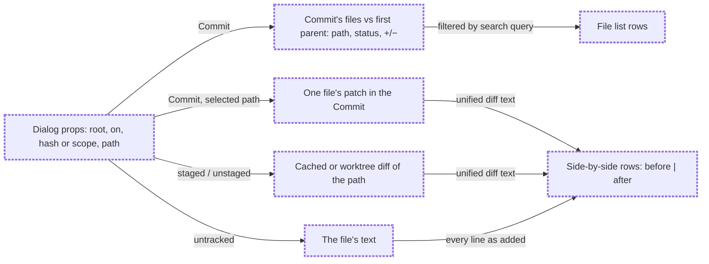

# Review dialog

Status: approved

## Problem Statement

A click on a changed file in the Git Graph or in the Changes panel opens Better Changes' diff in a centre tab. That tab is a full editor surface: it has its own toolbar, an inline or split toggle, a Full file button, and it takes the place of the terminals. The person only wants to read the change.

For a Commit, the centre tab shows one file at a time. To read the other files of the same Commit, the person goes back to the panel and clicks the next one. The tab gives no overview of the whole Commit, and no way to find a file in it by name.

The centre tab also carries a look that the rest of the layout dropped: rounded controls and coloured buttons, while the layout follows Zed's flat look.

## Solution

A new Review dialog opens over the window, in Zed's flat look: square corners, 1px borders, no shadow, no extra buttons.

- **A Commit's file** (a click in the Git Graph, or in the Changes panel's commit list) opens the dialog for the whole Commit. A file list sits on the left, with a search field above it that filters the list by path. The clicked file is selected, and its side-by-side diff fills the right. Clicking another file in the list, or moving with the arrow keys, shows that file's diff.
- **A Working change** (a click on a staged, unstaged or untracked file in the Changes panel) opens the same dialog for that one file: the side-by-side diff only, with no list and no search field.

Escape closes the dialog. The side-by-side diff shows the before on the left and the after on the right, changed hunks with three lines of context, line numbers on both sides, removed lines tinted red and added lines tinted green.

## Flows

### How does a click reach the Review dialog?

```mermaid
flowchart LR
    graph["Git Graph · expanded Commit"] -->|click a file| commitDlg["Review dialog · Commit"]:::new
    commits["Changes panel · commit list"] -->|click a file| commitDlg
    working["Changes panel · staged / unstaged / untracked"] -->|click a file| fileDlg["Review dialog · one Working change"]:::new
    conflict["Changes panel · conflicts, branch range"] -->|click a file| centre["Better Changes centre tab"]
    commitDlg -->|type in search| commitDlg
    commitDlg -->|click a row, Up / Down| commitDlg
    commitDlg -->|Escape| back["Back where the click came from"]
    fileDlg -->|Escape| back
    classDef new stroke-width:3px,stroke-dasharray:4 2
```

Conflicts and the branch range group keep the existing centre tab.

### Where does the diff come from?



Every read is a read-only Git command or file read on the repository's machine.

## User Stories

1. As a reviewer, I want a click on a file of an expanded Commit in the Git Graph to open the Review dialog, so that I read the change without leaving the graph.
2. As a reviewer, I want the dialog to show every file of that Commit in a list, so that I can review the whole Commit in one place.
3. As a reviewer, I want the file I clicked to be selected when the dialog opens, so that I land on what I asked for.
4. As a reviewer, I want a search field above the file list, so that I can find a file in a large Commit by name.
5. As a reviewer, I want the search to match any part of the path, ignoring case, so that typing `sidebar` finds `views/sidebar.js`.
6. As a reviewer, I want the search field to have the keyboard when the dialog opens, so that I can type at once.
7. As a reviewer, I want the search to filter only this dialog's list, so that the Git Graph and Changes panels stay as they were.
8. As a reviewer, I want a message when no file matches the search, so that an empty list is not mistaken for an empty Commit.
9. As a reviewer, I want the up and down arrow keys to move to the previous and next file in the filtered list, so that I can step through the Commit without the mouse.
10. As a reviewer, I want each file row to show its Material file icon, its name, its folder, its added and removed line counts and its status letter, so that the list reads like the Changes panel.
11. As a reviewer, I want the dialog header to show the Commit's short hash, subject and file count, so that I know which Commit I am reading.
12. As a reviewer, I want a merge Commit's files measured against its first parent, so that the dialog lists the same files as the expanded Commit in the Git Graph.
13. As a reviewer, I want a click on a file of a Commit in the Changes panel's commit list to open the same dialog for that Commit, so that both places behave the same.
14. As a reviewer, I want a click on a staged file in the Changes panel to show only that file's staged change, so that I see what the next Commit will hold.
15. As a reviewer, I want a click on an unstaged file to show only that file's unstaged change, so that I see what I have not staged yet.
16. As a reviewer, I want a click on an untracked file to show the whole file as added, with an empty before, so that a new file is still readable.
17. As a reviewer, I want the Working change dialog to show the file's path and its status in the header, with no list and no search field, so that it stays minimal.
18. As a reviewer, I want the side-by-side diff to put the before on the left and the after on the right, so that I compare the two versions line by line.
19. As a reviewer, I want removed and added lines of a hunk to face each other, and unchanged lines to show on both sides, so that the columns stay aligned.
20. As a reviewer, I want an empty, dimmed cell where one side has no line, so that alignment gaps are visible.
21. As a reviewer, I want line numbers on both columns, so that I can refer to a line.
22. As a reviewer, I want hunk headers between hunks, so that I see where unchanged lines were skipped.
23. As a reviewer, I want both columns to scroll sideways together, so that long lines stay comparable.
24. As a reviewer, I want the diff drawn in my terminal font at 14px, so that code reads like code.
25. As a reviewer, I want a new file's before column and a deleted file's after column to stay empty, so that the kind of change is obvious.
26. As a reviewer, I want "Binary file" instead of a diff for a binary file, so that the dialog does not show garbage.
27. As a reviewer, I want a long diff cut at a line limit with a note saying so, so that a huge file does not freeze the window.
28. As a reviewer, I want a mode or submodule change to say so instead of showing an empty diff, so that I know why there is no text.
29. As a reviewer, I want a loading state while Git runs, and an error message if it fails, so that a slow or broken read is not silent.
30. As a reviewer, I want the dialog to work for a repository on another machine, so that remote spaces behave like local ones.
31. As a reviewer, I want Escape to close the dialog, so that I return to where I was.
32. As a reviewer, I want the dialog to have square corners, a 1px border, no shadow and no coloured buttons, so that it matches the flat layout.
33. As a reviewer, I want the dialog sized to most of the window, so that both columns have room.
34. As a reviewer, I want the dialog to be read-only, so that reviewing never stages, reverts or edits anything.
35. As a reviewer, I want clicking a file in the Git Graph to keep highlighting that file in the graph, so that I see what I opened.
36. As a reviewer, I want a status letter to be green for an added file, red only for a deleted file, and yellow for every other change (modified, renamed, copied, type change, conflict), in the Files, Changes and Git Graph panels and in the Review dialog, so that red always means a file is gone.

## Implementation Decisions

- **New mod, Review dialog.** A new mod owns the dialog and nothing else. Its manifest places it nowhere and declares a dialog overlay of 88% by 86% of the window with `frame: "none"`, so Herdr draws no rounded frame or shadow and the mod draws its own square 1px `border`.
- **How callers open it.** Mods cannot import each other's code, so the Git Graph and Better Changes open the dialog with `openOverlay({ mod, kind: "dialog", props })`. The props are the contract between the callers and the dialog:
  - A Commit: `{ kind: "commit", root, on, hash, path }`. `root` is the repository root, `on` the machine (absent for this computer), `hash` the full Commit hash, `path` the file to select first.
  - A Working change: `{ kind: "working", root, on, path, scope }`, where `scope` is `staged`, `unstaged` or `untracked`.
- **What the dialog reads.** All reads are read-only Git commands run through `exec` on `on`, with the same read-only flags the Git Graph uses (no optional locks, no fsmonitor, no index refresh), plus `--no-ext-diff --no-textconv --no-color` and literal pathspecs:
  - The Commit's header: its subject, from Git.
  - The Commit's files: name status and numstat against the first parent (`--diff-merges=first-parent`), as the Git Graph's expanded Commit does.
  - One file of a Commit: that Commit's patch for that path, three lines of context.
  - A staged file: the cached diff for that path. An unstaged file: the worktree diff for that path. An untracked file: the file's text, read with `readTextFile`, shown as all added.
  - Diffs of a Commit's files load when a file is selected, not all at once.
- **A pure diff module.** One module with no Herdr imports turns unified diff text into side-by-side rows: hunk headers, context lines on both sides, and removed lines paired with added lines in order, with an empty cell on the shorter side. It also applies the line limit and reports truncation, recognises binary and mode-only output, and filters a file list by a query (case-insensitive substring of the path). It is the main test seam. Better Changes already has `diffRows` and `splitDiffRows`; the Review dialog keeps its own copy of what it needs, since a mod cannot import from another mod's folder.
- **A Git reads module.** One module takes a `git(args)` runner, as the Git Graph's reads do, and returns the Commit's files, a file's diff lines, and the Working change's diff lines. It is the second test seam, tested against a real temporary repository.
- **Look.** Zed's flat look, theme tokens only:
  - Dialog background `background`, a 1px `border` on all sides, no radius, no shadow.
  - Header 42px, `chrome`, a 1px `border` below. Commit: short hash in `dim`, subject in `foreground`, truncated, file count in `dim`. Working change: path, then the status letter.
  - File list (Commit only): a 300px column with a 1px `border` on its right. The search field on top is 32px, square, with a 1px `border` below and no other frame. Rows are 28px, the Changes panel's row: Material icon, name, folder in `dim`, `+N` in `ansi2`, `−N` in `ansi1`, status letter coloured as the Changes panel colours it. The selected row is `selected`, hover is `hover`. Rows never round.
  - Diff: terminal font (`settings().font_family`, falling back to JetBrains Mono), 14px, 24px rows. Two halves of 50% with a 1px `border` between them. Each half has its own line-number column in `dim`. Removed rows have `ansi1` at a low alpha behind them, added rows `ansi2`. A missing cell is `border` at a low alpha. Hunk headers are `dim` on `surface`.
  - The Material icons come with the mod, as they do with Files, Changes and the Git Graph.
- **Keys.** The search field holds the keyboard on open. Up and Down move the selection in the filtered list. Escape closes the dialog (Herdr closes the top dialog on Escape). No other keys and no buttons.
- **Limits.** At most 3000 diff lines per file, lines over 2000 characters cut with `…`. The note "Showing the first 3000 lines" appears under the diff when cut.
- **Git Graph change.** A click on a file of an expanded Commit opens the dialog with a Commit's props, and still records the selected file so the row stays highlighted. It no longer writes Better Changes' shared selection or opens Better Changes' centre tab. Without the Review dialog mod installed, the click only highlights the file.
- **Better Changes change.** In the Changes panel, a click on a staged, unstaged or untracked file opens the dialog with a Working change's props. A click on a file in the commit list opens it with a Commit's props. Better Changes' centre diff tab code stays, still reachable for the scopes this spec does not move (see Out of Scope), but these clicks no longer open it.
- **Status colours, everywhere.** One rule for every status letter in the Files panel, the Changes panel, the Git Graph and the Review dialog: `A` is `ansi2` (green), `D` is `ansi1` (red), and every other letter (`M`, `R`, `C`, `T`, `U`) is `ansi3` (yellow). Today `M` uses the derived `blocked` token, which reads as red. Each mod keeps its own copy of the rule, since mods cannot share code.
- **Tracking.** The new mod folder is added to the repository's allowlist.

## Testing Decisions

- A good test drives the public function of a module with real input and checks what a person would see: the rows, the files, the message. It does not check private helpers or call order.
- **Pure diff module:** unit tests with unified diff text in, side-by-side rows out. Cases: context lines on both sides; removed and added runs of equal and unequal length; a new file (empty before); a deleted file (empty after); several hunks with their headers; the line limit and its truncation flag; binary and mode-only output; and the file filter (substring, case, no match).
- **Git reads module:** tests against a real temporary repository, with `GIT_CONFIG_GLOBAL=/dev/null`. Cases: a Commit's files with status and counts; a merge Commit measured against its first parent; one file's diff in a Commit; staged and unstaged diffs of the same file differ; an untracked file reads as all added.
- **Prior art:** the Git Graph's `tests/git.test.mjs` (real repository through a `git` runner) and `tests/detail.test.mjs` (pure parsing), run with `node --test`.
- **Render:** `herdr-app check` on the new mod, the Git Graph and Better Changes, then a look in the app with `herdr-app shot` at a Commit with many files, a long line, a new file and a deleted file. `herdr-app check` renders only the first state, so the shot is required.

## Out of Scope

- Comments, annotations, approving, or sending a review to an agent.
- Staging, unstaging, reverting or editing from the dialog.
- Syntax highlighting.
- An inline (one column) diff, a Full file view, or any toggle.
- Conflicted files: they keep opening Better Changes' conflict view in the centre tab.
- The Changes panel's branch range group ("committed" against a base) and patches handed over by other mods: they keep Better Changes' centre tab.
- Pull requests from GitHub. "PR" in conversation means a merge Commit.
- Selecting and copying text inside the diff beyond what the platform gives for free.

## Further Notes

- Inspiration: `vinaytiparadi/herdr-mods` `session-diff` (its side-by-side layout and its notes on gpui-kit: handlers inside virtual list rows, `#rrggbbaa` theme colours, a diff column that needs full height in a row) and `jakub-tucek/herdr-annotator` (its read-only Git reads). No code from either is copied.
- Terms follow `GLOSSARY.md`: Commit, Merge commit, Working change, Review dialog, Side-by-side diff.
