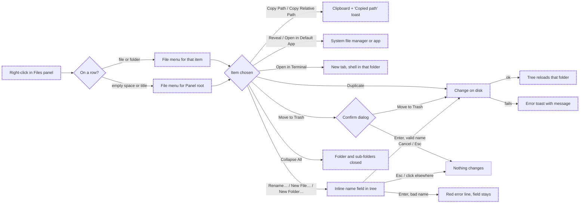

# File menu

Status: approved

## Problem Statement

In the `better-main` layout, the Files panel can only open things: a click opens a folder, previews a file, or opens a markdown file in the Markdown viewer. Everything else needs another program. To copy a file's path for an agent prompt, to show the file in the system file manager, to rename it, or to make a new file, the person leaves Herdr for a terminal command or another editor. Zed's project panel does all of this from a right-click, and the person wants the same here.

## Solution

A right-click on a file or folder in the Files panel opens the **File menu**: a small popup with the actions Zed offers for that item. A right-click on the panel's empty space or its title opens the File menu for the **Panel root**.

The menu has these items, in groups, and hides the ones that do not apply:

- Open in Default App, Reveal in File Manager (this computer only), Open in Terminal
- New File…, New Folder… (folders and the Panel root only: the new item goes inside)
- Copy Path, Copy Relative Path (relative to the Panel root)
- Rename…, Duplicate, Move to Trash (not for the Panel root)
- Collapse All (open folders only)

Rename and New ask for the name inline, in the tree row, like Zed. Move to Trash asks first. The tree updates by itself after every change.

## Flows

### What happens on a right-click in the Files panel?

The menu shows only the items that apply to the item (see Solution), so not every branch is offered every time.

## User Stories

1. As a person using the Files panel, I want a right-click on a file to open the File menu, so that I can act on that file without leaving Herdr.
2. As a person using the Files panel, I want a right-click on a folder to open the File menu for that folder, so that folder actions are as close as file actions.
3. As a person using the Files panel, I want a right-click on the empty space below the tree or on the panel title to open the File menu for the Panel root, so that I can make a new file at the top level.
4. As a person, I want the File menu to open at the pointer, so that it appears where I am looking.
5. As a person, I want the File menu to look like my other menus (square corners, 1px border, accent bar on the chosen row), so that the window stays consistent.
6. As a keyboard user, I want ↑/↓ to move in the File menu, Enter to run the item, and Esc to close it, so that I can use it without the mouse after it opens.
7. As a person, I want "Copy Path" to put the item's absolute path on the clipboard, so that I can paste it into an agent prompt.
8. As a person, I want "Copy Relative Path" to put the path relative to the Panel root on the clipboard, so that I get the short path that matches the tree I see.
9. As a person, I want a short "Copied path" notification after a copy, so that I know the copy worked.
10. As a person, I want "Reveal in File Manager" to open the system file manager at the item's folder with the item selected, so that I can find it there.
11. As a Linux person, I want Reveal to ask the file manager over D-Bus to select the item, and to fall back to opening the parent folder if that fails, so that it works with any file manager.
12. As a macOS person, I want Reveal to show the item in Finder, so that the menu works there too.
13. As a Windows person, I want Reveal to show the item in Explorer, so that the menu works there too.
14. As a person, I want "Open in Default App" to open the item with the program my system uses for it, so that I can open a PDF or an image from the tree.
15. As a person working in a space on another machine, I want Reveal and Open in Default App to be hidden, so that I do not get actions that cannot work on that machine.
16. As a person, I want "Open in Terminal" to open a new tab in the current space with a shell in that folder (the parent folder for a file), so that I can run commands there at once.
17. As a person, I want "New File…" on a folder to open the folder and show an empty name field at the top of its children, so that I type the name where the file will appear.
18. As a person, I want "New Folder…" to work the same way and make a folder, so that both are one gesture.
19. As a person, I want Enter in the name field to make the item and Esc or a click elsewhere to cancel, so that the field behaves like Zed's.
20. As a person, I want a new file not to open by itself, so that making several files in a row stays fast.
21. As a person, I want "Rename…" to replace the row's name with a field holding the current name, so that I edit it in place.
22. As a person, I want the name part before the extension selected when the rename field opens, so that typing a new name keeps the extension.
23. As a person, I want Enter with an unchanged name to close the field and change nothing, so that an accidental rename does nothing.
24. As a person, I want an empty name, a name with `/`, `.` or `..`, or a name that already exists in that folder to show a red error line under the field and keep the field open, so that I can fix the name instead of losing it.
25. As a person, I want a file previewed in the panel to stay previewed under its new name after a rename, so that the preview does not break.
26. As a person, I want "Duplicate" to make a copy next to the item named like Zed's (`report copy.md`, then `report copy 2.md`, a folder `src copy`), so that I get a copy without typing a name.
27. As a person, I want "Move to Trash" to ask "Move `<name>` to Trash?" first, with Move to Trash and Cancel buttons, Enter to confirm and Esc to cancel, so that one wrong click does not lose a file.
28. As a person, I want Move to Trash to use the system trash, so that I can get the item back.
29. As a person, I want the confirm dialog to look like my menus (square corners, 1px border), so that it matches.
30. As a person, I want no Permanent Delete item, so that no menu action loses data for good.
31. As a person, I want "Collapse All" on an open folder to close it and every folder inside it, so that a deep tree folds in one step.
32. As a person, I want the Panel root's menu to leave out Rename, Duplicate and Move to Trash, so that I cannot remove the folder the panel shows.
33. As a person, I want a failed action (no `gio` on a remote machine, a permission error) to show an error notification with the command's message, so that I know why nothing changed.
34. As a person, I want successful changes to show no notification and the tree to update at once, so that the panel stays quiet.
35. As a Windows person, I want the items that change files (New, Rename, Duplicate, Move to Trash) hidden, so that I do not get actions that are not built there yet.
36. As a person whose Markdown viewer tab shows a file I rename or trash, I want that tab to keep today's behaviour ("This file is no longer available"), so that nothing surprising happens.

## Implementation Decisions

- **The menu is `my-menu` with a new `file` kind.** `my-files` opens `my-menu` as a pointer popup (`frame: "none"`, as the space and tab menus do) with props `{ tab: "file", target: { path, dir, root, on, isRoot, open, platform } }`. `my-menu` builds the item list from the target. Each item's command is a mod command, `my-files.<action>`, which Herdr delivers to `my-files`'s `nextCommand()`. This reuses the existing menu look and keyboard handling, and needs no new state channel: `my-files` keeps the right-clicked target until the next right-click.
- **`my-files` runs every action.** It listens on `nextCommand()` for `copy-path`, `copy-relative-path`, `reveal`, `open-default`, `open-terminal`, `new-file`, `new-folder`, `rename`, `duplicate`, `trash`, `trash-confirmed` and `collapse-all`, and acts on the kept target. Clipboard writes use `cx.write_to_clipboard`. Program runs use `exec(..., { on })`, so a remote space's changes run on its machine.
- **Pure modules, no Herdr imports.** *Menu items* lives in `my-menu` (`mods/my-menu/menu-items.js`), its only user: a mod cannot import from another mod's folder (`herdr-app check` rejects it as "resolves outside the application directory"). *Names* and *commands* live beside `my-files`.
  - *menu items*: given the target, returns the ordered item list with group breaks. It applies the visibility rules: local-only items, folder-only items, root rules, write items hidden on Windows, Collapse All only for open folders.
  - *names*: the relative path from the Panel root; the next free duplicate name given a name and the folder's existing names; name validation (empty, `/`, `.`, `..`, taken) returning an error message or none.
  - *commands*: for each action and platform, the program and arguments to run. Linux Reveal is `gdbus call --session --dest org.freedesktop.FileManager1 --object-path /org/freedesktop/FileManager1 --method org.freedesktop.FileManager1.ShowItems "['file://<path>']" ""`, falling back to `xdg-open <parent>`; macOS `open -R`; Windows `explorer /select,<path>`. Open in Default App reuses the Markdown viewer's opener rule (`xdg-open`, `open`, `rundll32 url.dll,FileProtocolHandler`). Trash is `gio trash` on Linux and a Finder `osascript` call on macOS. File changes go through `sh` with paths as positional arguments, never spliced into the script. New and Rename refuse to overwrite: they fail if the target exists, even if it appeared after validation.
- **Inline name field.** One edit at a time, held by `my-files`: `{ kind: "new-file" | "new-folder" | "rename", folder, original? , error? }`. The field is a `gpui-base` `Input` in the tree row (rename) or a new row at the top of the folder's children (new). Enter validates, then runs the command; Esc or focus loss cancels. A new edit cancels any open one.
- **Confirm dialog.** `my-confirm`, a clone of Herdr's `confirm` with `frame: "none"`, square corners and a 1px border, recorded in `docs/upstream-forks.md`. `my-files` opens it with `command: { name: "my-files.trash-confirmed" }`.
- **Refresh.** After each successful change `my-files` reloads the affected folder at once instead of waiting for the folder watch or the 10-second timer. Remote spaces have no watch, so this is their only prompt refresh.
- **Right-click on rows** uses `on_mouse_down("right", …)` on each row; the tree container and the header get the Panel root handler. A right-click while an inline edit is open cancels it first.
- **Mod command reach.** Herdr delivers `my-files.<action>` to shown copies only. The Files panel is shown whenever its menu is open, so this holds; if the panel is hidden before the item runs, the action is dropped.

## Testing Decisions

- A good test drives a module through its public functions and checks results the person would see: the item list, a path string, a file on disk. It does not check private state or call order.
- **Menu items module**: table tests over target shapes (file, folder, open folder, Panel root, remote, Windows) asserting the labels and their order.
- **Names module**: relative paths (nested, root itself, trailing slash), duplicate names (`a.md`, `a copy.md` taken, dot files, no extension, folders), validation cases.
- **Commands module**: assert the program and arguments per platform; for the `sh` file changes, run them for real in a temporary folder with node's `child_process` and assert the files on disk, including names with spaces, quotes and leading dashes, and the refusal to overwrite.
- **Mods**: `herdr-app check` on `my-files`, `my-menu` and `my-confirm` after every change.
- **In the app**: right-click a file, a folder and the empty space in `better-main`; run each item once; take `herdr-app shot` of the menu, an inline field with an error, and the confirm dialog.
- Prior art: `my-files` `file-kind` and `viewer-tabs` tests and `md-viewer` `links` tests: ESM modules with no Herdr imports, run with `node --test tests/`.

## Out of Scope

- Cut, Copy and Paste of files; Undo and Redo.
- Permanent Delete.
- Git items: Add to .gitignore, View History, Restore, Compare.
- Find in Folder, Expand All, Open Markdown Preview from the menu, Download from a remote machine.
- Selecting several items at once.
- Keyboard shortcuts in the tree (F2, Delete) and making the Files panel focusable.
- File-changing items on Windows.
- Keeping a Markdown viewer tab in step when its file is renamed or trashed.
- Drag and drop to move files.

## Further Notes

- Source for the item set: Zed's project panel menu, `deploy_context_menu` in `crates/project_panel/src/project_panel.rs` (zed-industries/zed at commit `72ff4e0`).
- `my-menu` and `my-confirm` are Herdr forks; the fork note lists `my-menu`'s new `file` kind and the new `my-confirm` fork.
