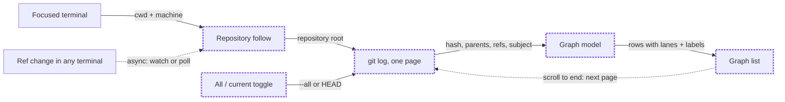

# Git Graph panel and icon-only tabs

Status: approved

## Problem Statement

The right panel of the `better-main` layout has two tabs: Files and Changes (Better Changes). Neither one shows how the branches of a repository relate to each other: where a feature branch forked, which commits are merged, where `origin` is, and which tag sits where. To see that, the person leaves Herdr for `git log --graph` or another tool.

The tab bar also uses text that the person does not want. The panel buttons say "Files" and "Changes". The terminal tabs show a program name. The pills in Better Changes say "Changes" and "Commits". The person wants icons only, with a tooltip that names each one.

## Solution

1. A new mod, **Git Graph**, is the third child of the right panel stack, beside Files and Changes. It draws the commit history of the focused terminal's repository as coloured lanes. Each commit row shows a node, the subject, branch and tag labels, the author and the age. The checked-out branch and HEAD are marked. Click a commit to expand it in place: the full message, a hash you can copy, the author, the date and the changed files. Click a file to open its diff in the Better Changes centre tab. The panel is read-only: it never checks out, merges, resets or fetches.
2. A personal clone of Herdr's `tabs` mod, named `my-tabs`, replaces `tabs` in `better-main`. The clone shows the panel buttons (Files, Changes and Git Graph) as icons only, and each button has a tooltip. Terminal tabs show only the program icon, with the tab's name in a tooltip.
3. Better Changes changes its header pills (Changes and Commits) to icons with tooltips. The count badges stay.

## Flows

### Where does the graph's data come from?



### How does a person get from the tab bar to a diff?

```mermaid
flowchart LR
    bar["Tab bar · icon buttons"]:::new -->|"click Git Graph icon"| graph["Right panel · Git Graph"]:::new
    graph -->|"click same icon"| closed["Panel hidden"]
    graph -->|"click commit"| expanded["Commit expanded in place"]:::new
    expanded -->|"click commit again"| graph
    expanded -->|"copy icon"| clip["Hash on clipboard"]:::new
    expanded -->|"click file"| diff["Centre tab · Better Changes diff"]
    classDef new stroke-width:3px,stroke-dasharray:4 2
```

The file click writes the Better Changes selection in its `commit` scope, so the diff tab is the one Better Changes already owns per space. Git Graph opens no tab of its own.

## User Stories

1. As a developer, I want a Git Graph button in the tab bar, so that I can open the graph with one click.
2. As a developer, I want the Git Graph button to close the panel when the graph is already showing, so that it works like the Files and Changes buttons.
3. As a developer, I want the panel to remember per space that Git Graph was open, so that a space switch restores my choice like it does for Files and Changes.
4. As a developer, I want the graph to follow the repository of the focused terminal, so that it always shows the code I am working on.
5. As a developer, I want the graph to follow a terminal on another machine and run Git there, so that remote spaces work too.
6. As a developer, I want each branch drawn as its own coloured lane, so that I can see parallel work at a glance.
7. As a developer, I want curves where a branch forks and where it merges, so that I can see where work split and joined.
8. As a developer, I want merge commits drawn in a muted colour, so that real work stands out.
9. As a developer, I want labels for local branches, remote branches and tags on their commits, so that I know where each ref points.
10. As a developer, I want one label for a local branch and its remote when both point at the same commit (for example `main | origin`), so that the labels take less space.
11. As a developer, I want the checked-out branch's label marked with a ✓ and the HEAD commit marked with a ring, so that I can see where I am.
12. As a developer, I want all local and remote branches shown by default, so that I can see the whole repository.
13. As a developer, I want a toggle that shows only the current branch's history, so that I can focus on my branch.
14. As a developer, I want my toggle choice remembered, so that the graph opens the same way next time.
15. As a developer, I want the first 300 commits to load at once, and the next 300 each time I scroll to the end, so that large repositories stay fast.
16. As a developer, I want the graph to reload when refs change (a commit, a checkout or a fetch in any terminal), so that it is never out of date.
17. As a developer, I want a refresh button, so that I can force a reload.
18. As a developer, I want to click a commit and see its full message, author, date and changed files in place, so that I keep my position in the graph.
19. As a developer, I want to copy a commit's full hash with one click, so that I can paste it into a terminal or an agent prompt.
20. As a developer, I want to click a changed file and see its diff in the Better Changes centre tab, so that diffs open where I already read them.
21. As a developer, I want a second click on an expanded commit to collapse it, so that the graph stays clean.
22. As a developer, I want the panel to say "Not a Git repository" when the focused folder is not in a repository, so that I know why it is empty.
23. As a developer, I want an empty repository (no commits) to show a clear message, so that the panel never looks broken.
24. As a developer, I want the graph to use the theme colours, so that it fits light and dark themes.
25. As a developer, I want the panel to look like Better Changes (the same header height, radius, fonts and row heights), so that the right panel feels like one product.
26. As a developer, I want the panel to read only, with no writes to my repository, so that a stray click can never change my repository.
27. As a developer, I want the panel buttons in the tab bar to show only icons, so that the tab bar has more room for tabs.
28. As a developer, I want a tooltip on each icon-only panel button ("Files", "Changes", "Git Graph"), so that I can still tell them apart.
29. As a developer, I want terminal tabs to show only the program icon, so that many tabs fit in the bar.
30. As a developer, I want a tooltip with the tab's name on each icon-only terminal tab, so that I know which tab is which.
31. As a developer, I want a tab with no program icon to show a generic terminal icon, so that no tab is blank.
32. As a developer, I want the active tab's close button, status spinner, status dot, drag-to-reorder, double-click rename and right-click menu to keep working, so that icon-only tabs lose no behaviour.
33. As a developer, I want the Changes and Commits pills in Better Changes to show only icons and their count badges, so that the panel header is compact.
34. As a developer, I want tooltips on the Better Changes pills, so that I know which tab is which.
35. As a developer, I want the window buttons (minimize, maximize, close) and the + button to stay as they are, so that nothing else in the tab bar changes.
36. As a developer, I want my layout, mods and these docs tracked in a local Git repository, so that I can see and undo each change.

## Implementation Decisions

- **New mod `git-graph`.** It has `place: none` and is added by hand to `better-main` as the third child of the `panel-body` stack, with the node id `git-graph`. The mod has these parts:
  - A pure **graph model**. It takes the raw output of one `git log` call and returns rows. Each row holds a commit, its lane, the edges that pass through or join the row, and its ref labels. It has no Herdr imports, so it can be tested on its own. Lane assignment is the usual one: a commit takes the lane of the first child that waits for it, its first parent keeps that lane, and other parents get free lanes. Lanes are reused after they close.
  - A **reads** part. It runs Git through `exec(..., { cwd, on })` with the same read-only flags as Better Changes (`--no-optional-locks`, `core.fsmonitor=false`). It uses one `git log` call with a NUL-separated format that holds the hash, the parents, the author, the date, the subject and the ref names (`%D`), in `--date-order`. With the toggle on, it uses `--all`. With the toggle off, it uses only `HEAD`. `--skip` gives the pages. It reads one commit's files with `git show --numstat --name-status -z --format=`.
  - A **view** part. It is one `v_virtual_list` of fixed-height rows. The graph column is drawn from small absolutely-positioned `div`s for lines and nodes, because a mod can't draw paths. Curves are drawn as short diagonal steps inside a row. If those steps look poor, the curves fall back to right-angle joins. An expanded commit adds rows under its row, inside the same list.
- **Repository following** copies Better Changes: a timer every 300ms checks the focused terminal's `cwd` and machine, then `git rev-parse --show-toplevel`. Local repositories use `watchFolder` on the `.git` folder to catch ref changes. Remote repositories poll every 10 seconds.
- **Look** reuses the Better Changes design kit values (a 42px header, 28px rows, radius 10, theme tokens). The lane colours cycle through the theme's `ansi` colours. The mod keeps its own copy of the few kit pieces it needs. A mod can't import from another mod's folder.
- **Interface with Better Changes:** to open a file's diff, Git Graph writes `shared("better-changes.diff-tabs")[space]` and `shared("better-changes.selection")` in the shape that Better Changes' own `pick` writes for scope `commit`. That shape is `source = { cwd: <repository root>, on }` and `context = JSON.stringify(source)`, and the selection carries `commit { hash, short, subject }` and `file { path, add, del, binary, status }`. Then Git Graph renames and selects the diff tab, or opens one with `tab.new` and `mod: "better-changes"`. Git Graph depends on this shape. If Better Changes is not installed, a file click does nothing beyond highlighting the file.
- **Preferences** (the branch toggle) are kept in the mod's `localStorage`.
- **`my-tabs`** is made with `mod.clone {name: "tabs", as: "my-tabs"}`, and the `tabs` block of `better-main` points at it. Changes:
  - The panel buttons become 26px squares with only an icon and `.tooltip(label)`. A third button, `git-graph`, uses an icon from the `git-graph` mod. The list of enabled panels always includes `git-graph`, as well as whatever `shared("workspace.panels")` holds.
  - The terminal tab pill shows only the program icon, or a generic terminal icon when there is none. It also shows the status spinner or dot and, when the tab is active, the close button. `.tooltip(name)` gives the tab's name, with the zoom mark.
- **Better Changes** is edited in place. It is a third-party mod, not one Herdr ships, so it is not restored on start. The `HeaderTab` component takes an `icon` and a `tooltip` in place of the visible label, and keeps the badge. Reinstalling Better Changes from upstream would undo this change. The spec accepts that.
- **Local repository:** `~/.config/herdr-app` is now a Git repository on the branch `feat/git-graph`, with an allowlist `.gitignore` that tracks only `docs/`, `keys.json`, `settings.json`, `layouts/better-main.json` and the person's own mods. It never pushes.

## Testing Decisions

- A good test checks behaviour you can see from outside: given a repository's history, the rows and lanes come out right, and given a mod, `herdr-app check` passes and the screenshot shows the expected UI. Tests don't check private helpers or exact pixel positions.
- **Seam 1, the graph model (main seam):** `node --test` against the pure model module, imported straight as ESM. Cases: a linear history, a branch and a merge, an octopus merge, two independent roots, lane reuse after a merge, ref label parsing (`HEAD -> main, origin/main, tag: v1`), and paging (a second page continues the lanes of the first).
- **Seam 2, real Git:** `node --test` builds temporary repositories with `git` (branches, merges, tags) and passes the real `git log` output through the model. This proves the log format and the parser agree. Prior art: Better Changes' `tests/changes.test.cjs`, which runs real Git in temporary folders.
- **Seam 3, the app:** `herdr-app check` for `git-graph`, `my-tabs` and `better-changes`. Then `herdr-app shot`, looked at on a real repository: the lanes, the labels, an expanded commit, the icon-only tab bar and the Better Changes pills. `herdr-app check` draws only the empty state, so the screenshot is required.

## Out of Scope

- Any action that writes to Git (checkout, branch, tag, merge, rebase, reset, cherry-pick, push or fetch). Agents and terminals do that.
- Showing many repositories at once (Manygit-style lists).
- Search and filter by author or message.
- Showing uncommitted changes as a row in the graph. Better Changes covers them.
- Changes to shipped layouts other than `better-main`, or to shipped mods other than through the `my-tabs` clone.
- Pushing the local repository anywhere.

## Further Notes

- Inspiration: `rabeeh-ta/herdr-git-graph` (a Git Graph in the style of VS Code, with lanes and labels) and `aBER0724/herdr-git-changes`, both from the Herdr gallery. No code from either is copied.
- The Herdr app rewrites `tabs` on every start, so `my-tabs` won't get later fixes to `tabs`. The clone records `cloned_from`.
- `herdr-app check` can't catch errors in rows that the virtual list draws later. Each UI ticket ends with a screenshot check.
