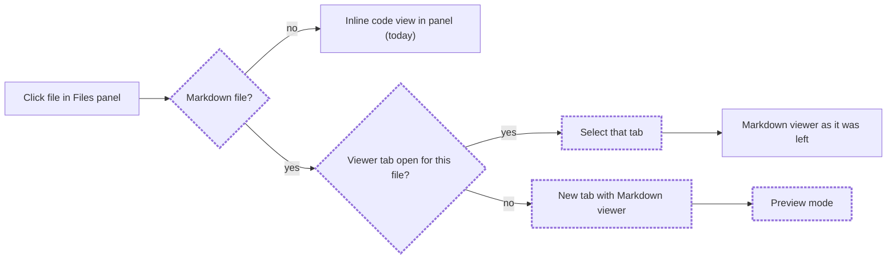
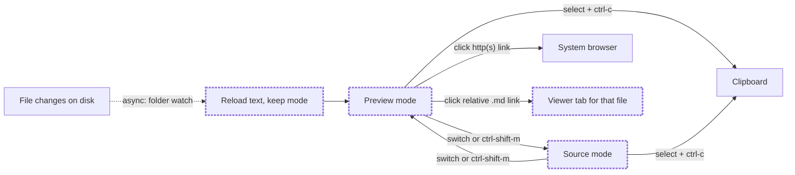

# Markdown viewer tab

Status: approved

## Problem Statement

In the `better-main` layout, the Files panel shows every file the same way: a click replaces the file tree with a small read-only code view inside the narrow right panel. For a markdown file, the person wants to read the document, not its source. The panel is too narrow for that, the markdown syntax (`#`, `**`, `|`) gets in the way, and the file tree is gone while the file is open. To read docs comfortably, the person leaves Herdr for an editor or a browser.

## Solution

A click on a markdown file in the Files panel opens it in a **Markdown viewer**: a new tab in the current space whose only pane shows the file.

- The tab opens in **Preview mode**: the document drawn as formatted text in a centred column, with real headings, bold and italic text, lists, task lists, quotes, tables and code blocks with syntax colours that follow the theme.
- A `Preview | Source` switch at the top of the tab, or `ctrl-shift-m`, changes to **Source mode**: the raw markdown with line numbers and markdown syntax colours.
- Both modes are read-only. The person can select text and copy it. Nothing edits the file.
- A second click on the same file goes to its open tab instead of opening another one.
- When the file changes on disk (for example, an agent edits it), the viewer reloads it.
- Web links open in the system browser. A relative link to another markdown file opens that file in its own viewer tab.
- Other files keep today's behaviour: the inline code view in the Files panel.

## Flows

### What happens on a click in the Files panel?



### Inside the Markdown viewer



## User Stories

1. As a developer, I want a click on a `.md` file in the Files panel to open it in its own tab, so that I can read it at full width.
2. As a developer, I want `.markdown` and `.mdx` files treated the same way as `.md`, so that every markdown document opens the same way.
3. As a developer, I want the file match to ignore letter case (`README.MD`), so that upper-case names work too.
4. As a developer, I want the viewer tab to open in the current space, so that the document stays beside the work it belongs to.
5. As a developer, I want the tab named after the file, so that I can find it in the tab bar.
6. As a developer, I want the tab bar to show a markdown icon for a viewer tab, so that I can tell it from a terminal.
7. As a developer, I want a second click on a file that is already open to select its tab, so that I do not get duplicate tabs.
8. As a developer, I want two files with the same name in different folders to open in two tabs, so that one does not hide the other.
9. As a developer, I want a closed viewer tab to be forgotten, so that the next click opens a new tab.
10. As a developer, I want the viewer to open in Preview mode, so that I read the document first.
11. As a developer, I want headings drawn larger and bold, so that the structure of the document is clear.
12. As a developer, I want bold, italic, strikethrough, inline code and links styled, so that emphasis reads as the author meant.
13. As a developer, I want bullet lists, numbered lists, nested lists and task lists drawn with markers and checkboxes, so that lists are easy to scan.
14. As a developer, I want quotes, tables and horizontal rules drawn, so that every common markdown block reads correctly.
15. As a developer, I want fenced code blocks drawn in a framed box with a mono font and syntax colours, so that code in docs is readable.
16. As a developer, I want the code colours to come from the current theme, so that the viewer matches the rest of the window.
17. As a developer, I want the text in a centred column no wider than a comfortable reading width, so that long lines stay readable on a wide window.
18. As a developer, I want prose in a sans-serif font with real bold and italic, so that the document looks like a document, not a terminal.
19. As a developer, I want to scroll through a long document, so that I can read all of it.
20. As a developer, I want to select text in Preview mode and copy it, so that I can paste parts of a doc elsewhere.
21. As a developer, I want to select text in a code block and copy it, so that I can run a command from a doc.
22. As a developer, I want a `Preview | Source` switch at the top of the tab, so that I can see the raw markdown.
23. As a developer, I want `ctrl-shift-m` to change the mode while the viewer has focus, so that I can switch without the mouse.
24. As a developer, I want Source mode to show line numbers and markdown syntax colours, so that the raw text is easy to read.
25. As a developer, I want to select and copy text in Source mode, so that I can copy exact markdown.
26. As a developer, I want each viewer tab to remember its own mode, so that switching tabs does not reset it.
27. As a developer, I want no way to edit the file in either mode, so that I cannot change a document by accident.
28. As a developer, I want the viewer to reload when the file changes on disk, so that I see an agent's edits without reopening.
29. As a developer, I want the mode kept across a reload, so that a live edit does not throw me back to Preview.
30. As a developer, I want a web link to open in my system browser, so that I can follow references.
31. As a developer, I want a relative link to another markdown file to open that file in its own viewer tab, so that I can move through linked docs.
32. As a developer, I want a message instead of a blank tab when the file is deleted, unreadable or binary, so that I know what happened.
33. As a developer, I want a very large file shown truncated with a note, so that the window stays responsive.
34. As a developer, I want a markdown file in a space on another machine to open from that machine, so that remote spaces work too.
35. As a developer, I want every other file type to keep the inline code view in the Files panel, so that nothing else changes.
36. As a developer, I want the viewer tab to survive a restart of Herdr, so that an open doc is still there.

## Implementation Decisions

- **New mod `md-viewer`.** A personal mod with `place: "none"`. It is opened only as the single pane of a tab, with props `{ file, on }`: `file` is the absolute path, `on` is the machine (null for this computer). It reads the file with `readTextFile(file, { on })`.
- **Preview rendering is hybrid** (decided from a prototype). The text is split into segments: fenced code blocks (``` and ~~~) and the markdown between them. Markdown segments are drawn with the built-in `TextView.markdown(id, text).selectable(true)`. Code segments are drawn with a read-only `Editor` (no line numbers, no folding, sized to its lines) with theme syntax colours, the same mapping as the Files panel's inline view (`keyword: ansi5, string: ansi2, comment: dim, function: ansi4, type: ansi3, number: ansi1, constant: ansi6`). The built-in `TextView` draws code blocks without syntax colours and in a small font, and its `highlight_theme` is not reachable from JavaScript.
- **Splitting is a pure module** with no Herdr imports, so `node --test` can import it. It follows CommonMark fence rules: a fence is three or more backticks or tildes, indented by up to three spaces, closed by a fence of the same character that is at least as long. An unclosed fence runs to the end of the file. A fence's info string gives the language.
- **Layout of Preview mode:** a scrolling column, centred, maximum width 860px, horizontal padding 40px, vertical padding 32px, text size 15px, line height 1.6, theme `background` and `foreground`. Code blocks: `surface` background, 1px `border`, radius 6, padding 12, terminal font from `settings().font_family`, 13px.
- **Font: bundled static Inter.** The prototype showed that Herdr draws variable fonts without bold: Adwaita Sans, Noto Sans and Geist lost bold and headings. Static Inter 4.1 TTFs (Regular, Italic, Bold, BoldItalic, SemiBold) from the official `rsms/inter` GitHub release, with its OFL license file, go in the mod's `fonts/` folder. Herdr loads mod fonts at start and on the next look change. If Inter is not available, the viewer falls back to the UI font.
- **Source mode** is a read-only `Editor` with `language: "markdown"`, line numbers on, soft wrap on, the terminal font, and the same syntax colour mapping. If the editor has no markdown grammar, the text still shows plain.
- **Mode switch:** a header row at the top of the tab with the file name and a two-segment `Preview | Source` control. The mode lives in the copy's own state, so each tab keeps its own. A new `mod:md-viewer` section in `keys.json` binds `ctrl-shift-m` to `md-viewer.toggle`, delivered through `nextCommand()`.
- **Read-only:** no write call exists in the mod. Editors are created with `readonly: true`.
- **Size limit:** text longer than 400,000 characters is cut there with a note, the same limit as the Files panel.
- **Reload:** for a local file, the viewer waits on `watchFolder` of the file's folder and rereads the file when its path is in the change list or the folder root is returned. For a remote file, it rereads every 10 seconds and redraws only when the text changed. The mode is kept; the Preview scroll position is not guaranteed.
- **Links:** `TextView.on_link_click` receives each link. `http:` and `https:` URLs open with the system opener (`xdg-open` on Linux, `open` on macOS, `start` on Windows) through `exec`. A relative link whose path ends in a markdown extension resolves against the file's folder and opens through the same open-or-select logic as the Files panel. A link with only an anchor (`#section`) does nothing. Other links do nothing.
- **Changes to `my-files`:** a pure `isMarkdown(name)` check (case-insensitive `.md`, `.markdown`, `.mdx`). A click on a markdown file calls the open-or-select logic instead of the inline view. All other clicks are unchanged.
- **Open-or-select:** `run` returns null and a mod pane's `props()` holds only what it was given, so neither side learns the new tab's id directly (verified with a probe mod). The opener keeps a shared registry `"md-viewer.tabs"`: tab id to `{ file, on }`. To open, it looks up a live tab for the same `file` and `on` (a tab is live while `spaces()` still lists it and `panes()` shows an `md-viewer` pane in it) and runs `tab.select {id}`. Otherwise it records the pending file, snapshots the current `md-viewer` tab ids and runs `tab.new { name: <file name>, mod: "md-viewer", props: { file, on } }`. On the next render that shows an `md-viewer` tab not in the snapshot, it binds that tab id to the pending file. Entries for tabs that are gone are dropped when the registry is read. The lookup and pruning are pure functions over the registry, `spaces()` data and `panes()` data. Both `my-files` and `md-viewer` (for relative links) use the same logic; each mod keeps its own copy, since a mod cannot import from another mod's folder.
- **Tab icon:** `my-tabs` shows the Material markdown icon for a tab whose pane is an `md-viewer` mod, instead of the terminal glyph.
- **`.gitignore`:** add `!/mods/md-viewer/` so the new mod is tracked.
- **Upstream note:** `docs/upstream-forks.md` records the new `my-files` and `my-tabs` behaviour.

## Testing Decisions

- A good test checks behaviour through a module's public functions with real inputs: markdown text in, segments out; registry and live data in, decision out. Tests do not inspect GPUI elements.
- **Seam 1: the segment splitter** (`md-viewer`), with `node --test`. Cases: no fences; one ``` fence with a language; a ~~~ fence; a longer closing fence; a shorter inner fence that does not close; a fence indented by three spaces and one indented by four (not a fence); an unclosed fence; empty file; markdown before and after code.
- **Seam 2: open-or-select** (pure registry functions, one copy in each mod, the same tests in each), with `node --test`. Cases: no registry selects nothing and asks to open; a live entry for the same file and machine selects it; the same file on another machine opens a new tab; an entry whose tab is gone is pruned; a new `md-viewer` tab after a pending open is bound; an unrelated new tab is not bound.
- **Seam 3: `isMarkdown`** in `my-files`, with `node --test`, next to the existing `fileKind` tests.
- **Seam 4: relative link resolution** (`md-viewer`), with `node --test`: `./other.md`, `../docs/a.md`, `a.md#part`, URL-encoded spaces, `https://`, `#anchor`, `mailto:`.
- **App checks:** `herdr-app check` passes for `md-viewer`, `my-files` and `my-tabs`. In the running app, a click on a real markdown file opens the tab; `herdr-app shot` shows Preview mode with bold headings and coloured code; the switch shows Source mode; a second click selects the same tab; an edit to the file on disk updates the view.
- **Prior art:** `mods/my-files/tests/file-kind.test.js` (pure module, `node:test`, ESM import) and the git-graph model tests.

## Out of Scope

- Editing, saving or formatting markdown.
- Images in markdown (local or remote). They may show as alt text or not at all.
- Mermaid, math and HTML blocks beyond what `TextView` draws by itself.
- A table of contents, in-document search, or jumping to `#anchor` links.
- Opening markdown files from anywhere other than the Files panel and the viewer's own links.
- A split view with Preview and Source side by side.
- Changing Herdr's shipped `files` mod or other layouts.

## Further Notes

- Prototype findings (2026-11-08, `herdr-app shot`): plain `TextView` with the UI mono font draws bold correctly but code blocks without colour. The hybrid with static Inter gives bold headings, bold and italic text, and coloured code.
- Text selection does not continue across the boundary between a markdown segment and a code block. Each one is selected on its own.
- Inter is licensed under the SIL Open Font License 1.1; keep its license file in the font folder.
- Known upstream issue: gpui-component's markdown code blocks keep parse-time syntax colours after a theme change ([longbridge/gpui-component#2618](https://upd.dev/longbridge/gpui-component/issues/2618)). The hybrid avoids it because code blocks use `Editor`.
